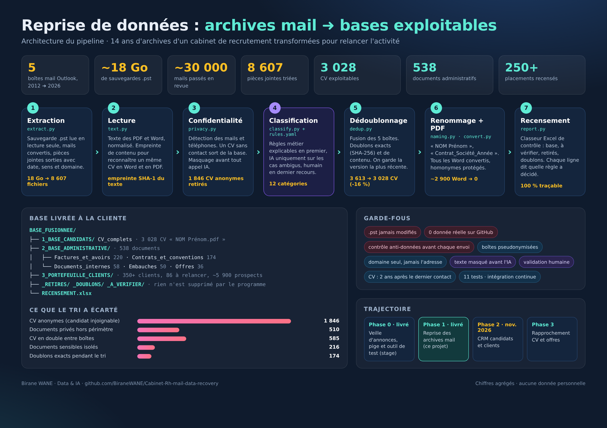
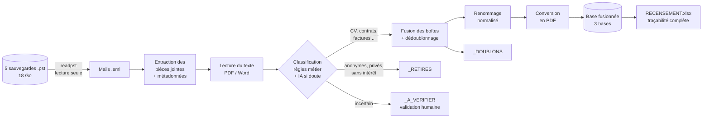
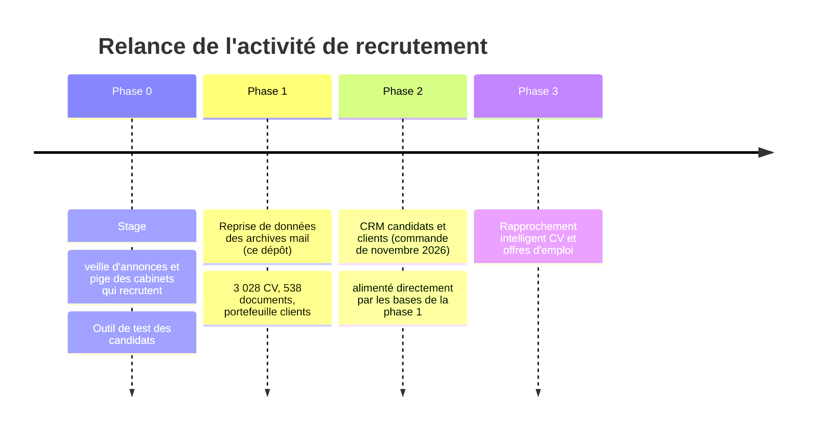

<div align="center">

# 📬 ➜ 🗂️ Cabinet RH : Mail Data Recovery

### 14 ans d'archives mail transformés en bases de données prêtes à relancer une activité de recrutement


**18 Go de sauvegardes Outlook · ~30 000 mails · 8 600 pièces jointes ➜ 3 028 CV exploitables, 538 documents administratifs, un portefeuille clients**

</div>

---

## 🎯 En une phrase

Une cliente, dirigeante d'un **cabinet de recrutement spécialisé dans l'expertise comptable**, voulait relancer de façon intensive une activité en sommeil depuis un à deux ans. Tout son capital, ses candidats, ses clients et ses contrats, dormait dans **5 boîtes mail saturées**, accumulées de **2012 à 2026**. Ce projet a extrait, trié, dédoublonné, renommé et structuré ce capital en **trois bases exploitables**.

> Ce dépôt est **public** mais ne contient **aucune donnée réelle** : ni CV, ni nom, ni adresse mail, ni client. Seulement le code, la méthode, des chiffres agrégés et des données fictives pour la démonstration. [Voir la politique de confidentialité](docs/confidentialite-rgpd.md).

---

<p align="center"><a href="docs/schema-architecture.pdf"></a></p>
<p align="center"><sub>📄 <a href="docs/schema-architecture.pdf">Télécharger le schéma en PDF</a></sub></p>

---

## 📊 Le point de départ : un volume énorme et désordonné

| | Avant |
|---|---|
| 📦 Boîtes mail Outlook | **5** boîtes (consultants, boîte candidats, direction) |
| 📅 Période couverte | **2012 ➜ 2026**, soit 14 ans d'activité |
| 💾 Sauvegardes .pst | **~18,3 Go** (la plus grosse : 10,7 Go) |
| ✉️ Mails passés en revue | **près de 30 000** (plus de 10 000 éléments dans une seule boîte) |
| 📎 Pièces jointes extraites et triées | **8 607** fichiers |
| 📝 Fichiers Word mélangés aux PDF | **~2 900** (.doc et .docx) |
| ⚠️ Problèmes rencontrés | doublons entre boîtes, CV anonymisés inutilisables, quittances et RIB mêlés aux candidatures, documents privés, données sensibles, noms de fichiers du type `CV_final_v2(3).doc` |

## ✅ Le résultat : une base propre, fusionnée, prête à servir

```
BASE_FUSIONNEE/
├── 1_BASE_CANDIDATS/
│   └── CV_complets/                    3 028 CV, tous nommés « NOM Prénom.pdf »
├── 2_BASE_ADMINISTRATIVE/               538 documents
│   ├── Contrats_et_conventions/          174   « Contrat_<Société>_<Année>.pdf »
│   ├── Factures_et_avoirs/               220   « Facture_<Client>_<Année>.pdf »
│   ├── Embauches_et_promesses/            50
│   ├── Offres_et_fiches_de_poste/         36
│   └── Documents_internes/                58
├── 3_PORTEFEUILLE_CLIENTS/
│   └── PORTEFEUILLE_CLIENTS.xlsx       placements, clients, contacts, relances, prospects
└── 4_RECENSEMENTS_PAR_BOITE/           un classeur de contrôle par boîte traitée
```

| Indicateur | Valeur |
|---|---|
| 👤 CV complets avant fusion des boîtes | 3 613 |
| 👤 CV après dédoublonnage entre boîtes | **3 028** (‑16 %) |
| 🚫 CV anonymisés retirés (ni mail ni téléphone : candidat injoignable) | 1 846 |
| ♻️ Doublons exacts écartés pendant le tri | 174 |
| 🔒 Documents privés hors périmètre isolés | 510 |
| 🛡️ Documents sensibles mis à part | 216 |
| 📄 Fichiers Word restants dans la base finale | **0** (100 % PDF) |
| 🤝 Placements recensés dans le portefeuille | plus de 250 |
| 🏢 Sociétés clientes identifiées | plus de 350, avec leurs contacts |
| 📈 Clients à relancer en priorité | 86 |
| 🎯 Prospects identifiés | près de 5 900 |

Les contrats et factures récupérés couvrent **2014 à 2026**, avec un pic d'activité en **2019** : la cliente dispose désormais d'un historique chiffré de son activité.

---

## 🛠️ Comment ça marche



| Étape | Module | Ce qui se passe |
|---|---|---|
| 1. Extraction | [`extract.py`](src/mailrecovery/extract.py) | Le .pst est converti en mails .eml **sans jamais être modifié**. Chaque pièce jointe est sortie avec sa date, son sens (reçue ou envoyée) et le domaine de l'expéditeur. Les logos de signature et les invitations d'agenda sont ignorés. |
| 2. Lecture | [`text.py`](src/mailrecovery/text.py) | Le texte des PDF et des Word est lu, puis normalisé (minuscules, sans accents). On en tire une **empreinte de contenu** qui reconnaît le même CV en Word et en PDF. |
| 3. Confidentialité | [`privacy.py`](src/mailrecovery/privacy.py) | Détection des mails et téléphones. Sert à la règle métier « un CV sans contact sort de la base » et au masquage avant tout envoi à un modèle d'IA. |
| 4. Classification | [`classify.py`](src/mailrecovery/classify.py) + [`rules.yaml`](config/rules.yaml) | 12 catégories. Des **règles écrites avec la cliente** décident dans la grande majorité des cas ; un modèle de langage peut être branché pour les cas ambigus ; le reste part en validation humaine. |
| 5. Dédoublonnage | [`dedup.py`](src/mailrecovery/dedup.py) | Deux niveaux : fichier identique (empreinte SHA‑256) et contenu identique (empreinte de texte). On garde la version la plus récente et la plus complète. Les versions différentes d'un même CV sont signalées pour comparaison. |
| 6. Renommage | [`naming.py`](src/mailrecovery/naming.py) | `CV_final_v2 marie DUPONT.doc` devient `DUPONT Marie.pdf`. Les homonymes ne s'écrasent jamais. |
| 7. Conversion | [`convert.py`](src/mailrecovery/convert.py) | Tous les Word sont convertis en PDF (LibreOffice sans interface). |
| 8. Recensement | [`report.py`](src/mailrecovery/report.py) | Classeur Excel : résumé chiffré, base, à vérifier, retirés, doublons. **Chaque ligne dit quelle règle a décidé.** |

📐 Détails techniques : [docs/architecture.md](docs/architecture.md) · 📚 Dictionnaire de données : [docs/dictionnaire-de-donnees.md](docs/dictionnaire-de-donnees.md) · 🧭 Choix et arbitrages : [docs/decisions.md](docs/decisions.md)

---

## 🧠 L'IA au bon endroit

Ce projet a été mené en **architecte IA**, pas en « tout‑IA » :

- **Un agent IA (Claude) a servi d'opérateur sur le poste de travail** : exploration des sauvegardes, propositions de classement, rédaction des recensements, toujours sous la supervision d'un humain qui validait chaque étape et chaque suppression.
- **Les règles métier restent la colonne vertébrale** : explicables, gratuites, rejouables, relisibles par la cliente dans un simple fichier YAML.
- **Le modèle de langage n'intervient que sur les cas ambigus** (interface `LLMClassifier`), et ne reçoit que du texte **masqué** : jamais un mail ni un téléphone.
- **Rien n'est supprimé automatiquement** : chaque document écarté est rangé dans un dossier qui dit pourquoi. La décision finale appartient toujours à l'humain.

Ce dépôt est la **version industrialisée** de la méthode appliquée sur les vraies archives : le même traitement, rejouable en une commande sur n'importe quelle boîte mail.

---

## 🚀 Essayer en 2 minutes (données 100 % fictives)

```bash
git clone https://github.com/BiraneWANE/Cabinet-Rh-mail-data-recovery.git
cd Cabinet-Rh-mail-data-recovery
pip install -e ".[dev]"

# Génère 3 boîtes mail fictives (CV, contrats, factures, doublons, pièges...) et les traite
mailrecovery demo --out demo_output
```

Sortie typique sur 300 mails fictifs :

```json
{
  "mails_lus": 300,
  "pieces_jointes_extraites": 239,
  "doublons_ecartes": 17,
  "documents_dans_la_base": 197,
  "documents_retires": 25,
  "cat_cv": 135,
  "cat_cv_anonyme": 11,
  "cat_contrat": 22,
  "cat_facture": 24
}
```

Sur de vraies sauvegardes (nécessite `pst-utils` et LibreOffice) :

```bash
mailrecovery run \
  --source boite_A=sauvegarde_A.pst \
  --source boite_B=sauvegarde_B.pst \
  --own-domain mon-cabinet.fr \
  --out BASE_FUSIONNEE/
```

Tests et qualité :

```bash
pytest -q                          # tests unitaires + test de bout en bout
ruff check src tests scripts       # qualité du code
python scripts/check_no_pii.py     # garde-fou données personnelles
git config core.hooksPath .githooks  # active le garde-fou avant chaque commit
```

---

## 🔒 Confidentialité by design

| Protection | Comment |
|---|---|
| Aucune donnée dans le dépôt | `.gitignore` qui exclut tous les formats de données (.pst, .pdf, .docx, .xlsx...) |
| Double garde‑fou automatique | [`check_no_pii.py`](scripts/check_no_pii.py) bloque tout commit et tout push contenant une adresse mail ou un numéro de téléphone réel |
| Boîtes pseudonymisées | les boîtes sont désignées `boite_A`, `boite_B`... jamais par le nom de leur titulaire |
| Minimisation | seul le domaine de l'expéditeur est conservé dans le recensement, jamais l'adresse complète |
| Sources intactes | les .pst sont lus en lecture seule et conservés tels quels |
| IA sous contrôle | texte masqué avant tout appel à un modèle ; données traitées sur le poste de la cliente |
| Durée de conservation | CV utilisés au plus 2 ans après le dernier contact avec le candidat (recommandation CNIL), candidats recontactés par mailing, droit de refus dans chaque message |

Détails : [docs/confidentialite-rgpd.md](docs/confidentialite-rgpd.md)

---

## 🗺️ Un projet dans une trajectoire

Ce projet est la deuxième brique d'un programme de relance complet mené pour la même cliente :



| Phase | Statut | Lien |
|---|---|---|
| **0. Veille d'annonces, pige et outil de test** : repérer automatiquement les cabinets qui recrutent, évaluer les candidats | ✅ Livré (stage) | [Outil_Test_Pige_Cabinet_Rh](https://github.com/BiraneWANE/Outil_Test_Pige_Cabinet_Rh) |
| **1. Reprise de données des archives mail** | ✅ Livré | ce dépôt |
| **2. CRM candidats et clients** : centraliser contacts, échanges, placements et relances | 🔜 Commandé, démarrage novembre 2026 | à venir |
| **3. Rapprochement CV et offres** : recherche sémantique dans la base de 3 000 CV pour proposer les bons profils à chaque offre | 💡 Envisagé | à venir |

---

## 👤 Auteur

**Birane WANE**, concepteur développeur en science des données et architecte IA.

Avant la data, j'ai travaillé dans le recrutement aux côtés de la cliente, au sein du même cabinet. Je connais donc le métier de l'intérieur : ce qui fait un bon CV de collaborateur comptable, ce qu'est un placement, ce qu'un cabinet attend. C'est ce double regard, data et métier, qui a permis d'écrire des règles de tri justes et de livrer une base que la cliente peut exploiter dès le premier jour.

📫 [github.com/BiraneWANE](https://github.com/BiraneWANE)

---

<sub>Licence MIT · Toutes les données de démonstration sont générées et fictives · Aucune donnée de la cliente, de ses candidats ou de ses clients n'est publiée.</sub>
