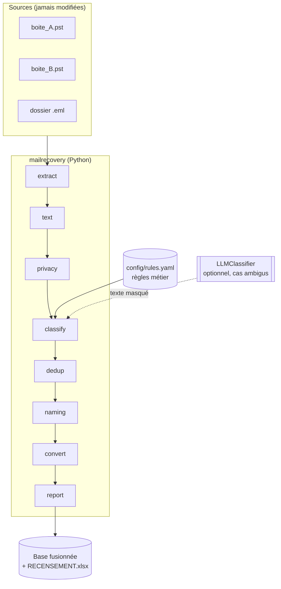

# Architecture

## Vue d'ensemble

## Déroulé réel du projet

Le traitement des vraies archives s'est fait **boîte par boîte**, de la plus petite à la plus grosse, pour valider la méthode avant de l'appliquer aux gros volumes :

| Ordre | Boîte | Volume | Ce que la boîte a appris à la méthode |
|---|---|---|---|
| 1 | boite_A (consultante) | 1,5 Go, depuis 2016 | Mise au point des catégories et des règles de nommage |
| 2 | boite_B + boite_C (direction et candidats, presque vides) | moins de 0,1 Go | Fusion de petites boîtes en un seul passage |
| 3 | boite_D (consultant) | 10,7 Go | Séparation du privé et du professionnel, isolement du sensible |
| 4 | boite_E (consultant) | 6,1 Go, plus de 10 000 éléments | Passage à l'échelle : traitement par année |
| 5 | Fusion des 4 dossiers de tri | 8 607 fichiers | Doublons entre boîtes, conversion PDF, renommage final |

Principes tenus du début à la fin :

1. **Sauvegarde complète avant toute action** : export .pst depuis Outlook (le glisser‑déposer ne copie pas tout), fichier jamais touché ensuite.
2. **Copie de travail séparée** : le tri se fait sur une copie, dans un dossier dédié.
3. **Ménage dans Outlook en dernier**, une fois la base vérifiée.

## Modules

| Module | Responsabilité | Entrée ➜ sortie |
|---|---|---|
| `extract.py` | .pst ➜ .eml ➜ pièces jointes + métadonnées | chemin ➜ `list[Attachment]` |
| `text.py` | lecture PDF/Word, normalisation, empreinte de contenu | fichier ➜ texte, empreinte |
| `privacy.py` | détection et masquage des mails et téléphones | texte ➜ booléens, texte masqué |
| `classify.py` | score par catégorie, règles métier, recours IA, seuil | `Attachment` ➜ catégorie + raison |
| `dedup.py` | doublons exacts et de contenu, choix de la meilleure version | liste ➜ (uniques, doublons) |
| `naming.py` | « NOM Prénom », « Contrat_Société_Année », homonymes | `Attachment` ➜ nom final |
| `convert.py` | Word ➜ PDF via LibreOffice | fichier ➜ PDF |
| `report.py` | classeur de recensement | listes ➜ .xlsx + statistiques |
| `pipeline.py` | orchestration, rangement, aucune suppression | sources ➜ base |
| `synthetic.py` | génération de boîtes fictives réalistes | graine ➜ dossiers .eml |

## Passage à l'échelle

- Le dédoublonnage par empreinte est en O(n) : 10 000 éléments se traitent en quelques minutes.
- La lecture se limite aux 5 premières pages et aux 20 000 premiers caractères : suffisant pour classer.
- La conversion PDF est l'étape la plus lente ; elle ne concerne que les documents conservés.
- Pour une très grosse boîte, l'export par année (comme pour boite_E) découpe le travail en lots.
